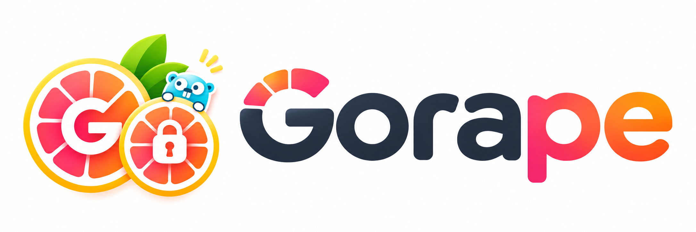

<p align="center">
  
</p>

# Gorape

Open Device Trust & Attestation Backend written in Go.

Gorape validates Keycloak access tokens, applies project/group RBAC, registers attested device public keys, verifies key possession, and records device lifecycle events. It is not an identity provider, certificate authority, or client-certificate issuer.

日本語の概要は [docs/README.ja.md](docs/README.ja.md) を参照してください。

## Architecture

```text
Native app / gorape-client
        | Authorization Code + PKCE
        v
     Keycloak
        | access token
        v
      Gorape ---- PostgreSQL (domains, roles, devices, audit)
        |
        +--------- Redis (single-use challenges)
```

Each Project maps to exactly one pre-registered Keycloak Realm issuer. A token's `iss + sub` identifies an `identity_principal`; no names, email addresses, or passwords are stored. Unknown issuers never trigger OIDC discovery.

## Status

- Project/Group multi-tenancy and admin/editor/viewer RBAC
- PostgreSQL constraints that enforce project boundaries
- Keycloak JWT signature, issuer, audience, expiry, not-before, scope, JWKS, and rotation validation
- Redis-backed 256-bit, short-lived, atomic single-use challenges
- Device registration, revocation, group assignment, public-key proof, and events
- Android Key Attestation certificate-chain, key-binding, and challenge verification
- Windows TPM and Apple verifiers fail closed as unsupported
- CLI login using Authorization Code + PKCE

Android deployment requires configured trust-anchor PEM files. Certificate revocation and application-identity policy are not yet implemented; see [SECURITY.md](SECURITY.md).

## Quick start

Requirements: Go 1.25+, Docker, and Docker Compose.

```bash
cp etc/server.yaml.example etc/server.yaml
cp etc/app.yaml.example etc/app.yaml
cp etc/admin.yaml.example etc/admin.yaml
make dev-up
make build
```

Bootstrap a Project after obtaining the Keycloak user's `sub`:

```bash
.bin/gorape-admin -c etc/admin.yaml bootstrap-project \
  --slug gorape --name Gorape \
  --issuer http://localhost:8080/realms/gorape \
  --realm gorape --admin-subject '<keycloak-sub>'
```

Production issuers must use HTTPS. The migration permits plain HTTP only for localhost development issuers.

Run the API and authenticate the CLI:

```bash
.bin/gorape -config etc/server.yaml
.bin/gorape-client -c etc/app.yaml login
.bin/gorape-client -c etc/app.yaml list projects
```

## Project layout

```text
cmd/server                 API entrypoint
cmd/client/{admin,app}     operations and API clients
pkg/config                 YAML, PostgreSQL, Redis, Secrets Manager
pkg/entity                 domain models and API DTOs (split by concept)
pkg/server/controller      Gin HTTP layer (split by concept with co-located interfaces)
pkg/server/usecase         Business rules (split by concept with co-located interfaces)
pkg/server/repository      GORM, OIDC, challenge adapters (split by concept with co-located interfaces)
pkg/client                 controller/usecase/repository client layers
migrations                 PostgreSQL migrations
docker, etc, scripts       inherited development tooling
test/{unit,integration,e2e}
docs/api                   OpenAPI and client protocol documentation
```

### Code Conventions

- **Concept-Oriented Structure**: Every layer (`entity`, `repository`, `usecase`, `controller`) splits files by conceptual entity (`project.go`, `group.go`, `device.go`, `role.go`), with non-concept / aggregators in `common.go`.
- **Interface & Constructor Co-location**: Each concept file defines its `interface`, concrete implementation struct, and a `New<Concept>(...)` constructor.
- **Receiver Naming**: All struct method receivers are consistently named `rcvr`.

## Development

```bash
make test
make build
make docs
```

The OpenAPI 3.1 contract is [docs/swagger/swagger.yaml](docs/swagger/swagger.yaml). See [CONTRIBUTING.md](CONTRIBUTING.md) and [SECURITY.md](SECURITY.md).

## License

MIT. Existing copyright is preserved in [LICENSE](LICENSE).
